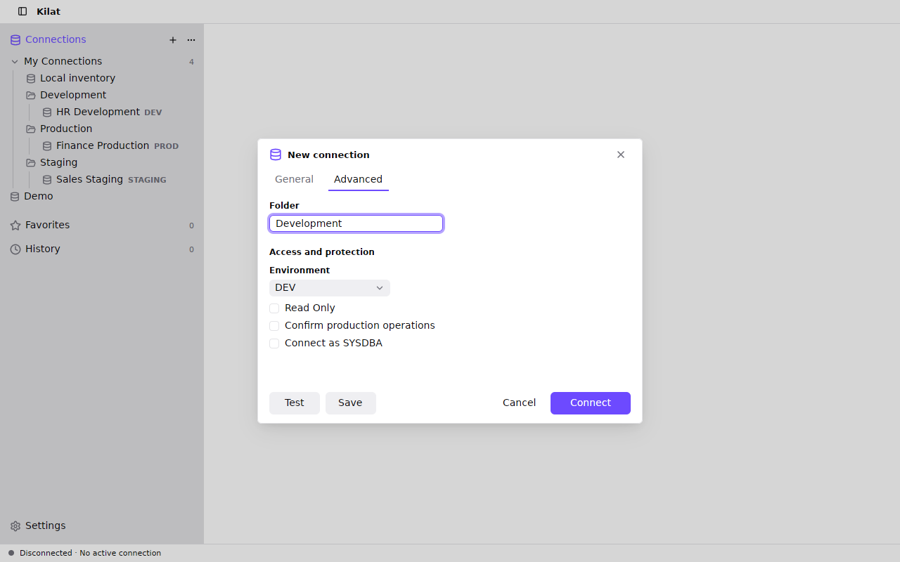
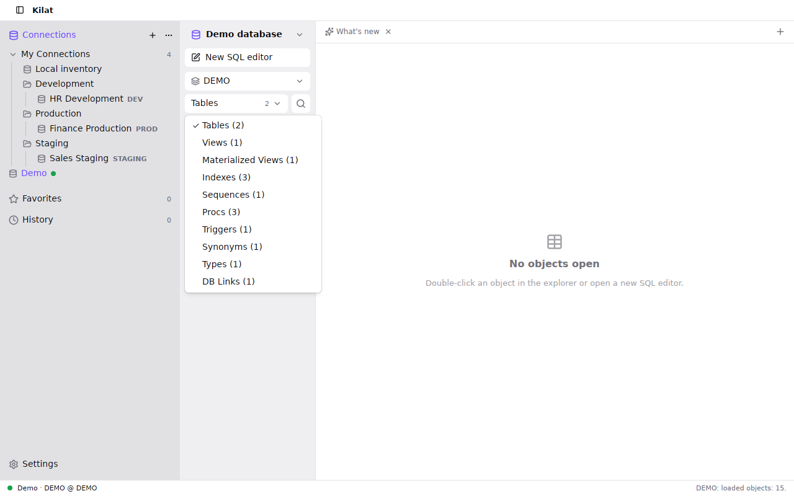
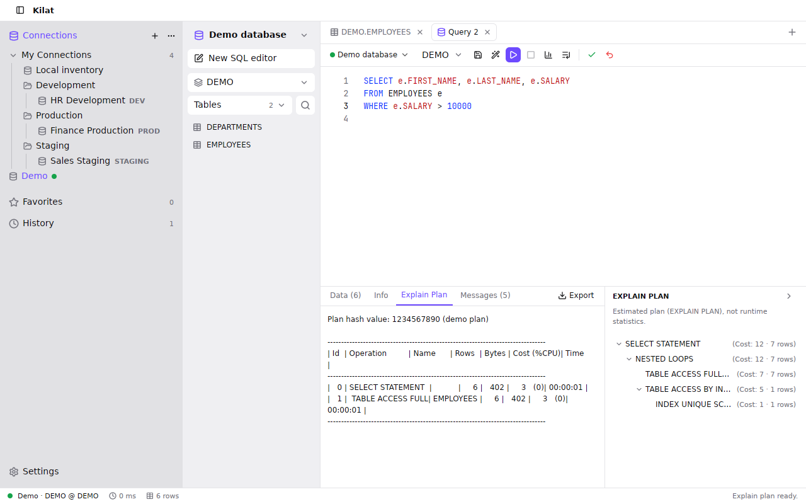
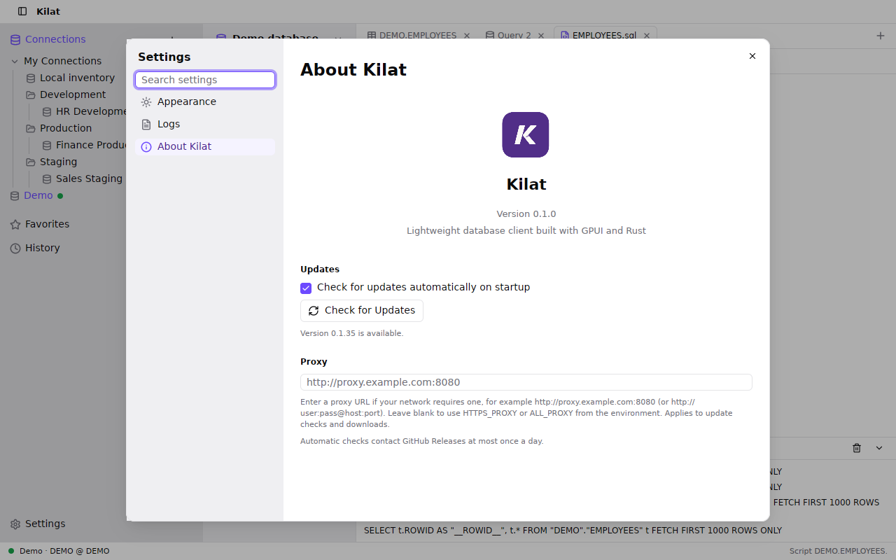
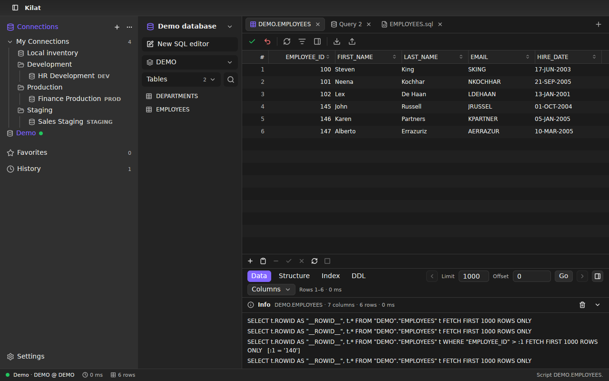

# Kilat

A fast, lightweight desktop database client for **Oracle**, written in Rust with [gpui-kit](https://gpui-kit.com). One binary, no Oracle Client or Instant Client needed: Oracle connections use the thin driver, which speaks Oracle Net directly. **SQLite, PostgreSQL, MySQL/MariaDB and SQL Server**, the **Redis** and **MailHog** developer tools, and **Dry-run** for Oracle are signed extensions you install from Settings > Extensions.

The explorer works like Toad (pick a schema, then browse objects by type), the connection sidebar and dialog follow Navicat, and the data grid borrows from TablePlus.


## Features

### Connections

- **Oracle**, as **Oracle · Basic** (host, port and service name as separate fields) or **Oracle · TNS** (a `tnsnames.ora` alias or a full connect descriptor), optionally as SYSDBA.
- Works with old accounts that only have a **10G password verifier**, which the upstream thin driver refuses (see [vendor/oracledb/PATCHES.md](vendor/oracledb/PATCHES.md)).
- **Extensions** (Settings > Extensions, one click Install, Update and Uninstall; each download is checked against its SHA-256 checksum and minisign signature):
  - **SQLite**: pick a database file with Browse. Changes are kept in a transaction until you Commit or Rollback.
  - **PostgreSQL** and **MySQL/MariaDB**: browse, edit rows, Data Transfer, and **Explain analyze** (the statement runs in a transaction that is always rolled back).
  - **SQL Server**: browse every database of a server, each data tab bound to its own database; read-only grid for now.
  - **Redis** and **MailHog** under Developer Tools, with an optional local server started by the extension.
  - **Dry-run** for Oracle: runs one `UPDATE` or `DELETE` without committing and shows the rows it would change, with an undo script.
- A connection whose extension is not installed shows as a grey row; clicking it opens Settings > Extensions.
- **Several connections open at once**, each with its own worker thread. Tabs belong to their connection; the connection pill in a SQL tab switches it to another open connection.
- **Folders** in the Connections sidebar: create, rename in place, colour, nest, drag connections between them.
- **Environment flag** per connection: DEV (green), STAGING (yellow) or PROD (red), shown next to the name.
- **Read Only** connections refuse edits, deletes, imports and other writes. **Confirm production operations** asks before every write on that connection.
- **Save password** stores the password in the OS keychain (macOS Keychain, Windows Credential Manager, Secret Service on Linux). It is never written to `connections.json`.
- **Import connections** from a Kilat JSON export or from a Toad for Oracle login file (`toadForOracleLogin*.txt`); imported Toad logins land in a "Toad" folder without passwords. **Export Kilat connections** writes a JSON file you can import on another machine.

| Connections sidebar | New connection | Advanced |
|---|---|---|
|  |  |  |
| **SQLite connection** | **SQLite data** | |
|  |  | |

### Explorer

- Schema dropdown, then an object type dropdown with counts: Tables, Views, Materialized Views, Indexes, Sequences, Procs (procedures, functions, packages), Triggers, Synonyms, Types and DB Links, plus a search box over a virtualized list. SQLite shows its tables, views, indexes and triggers.
- **Double click** a table or view to open its data in a new tab.
- **Right click** for Open Data, Describe, View Script (DDL from `DBMS_METADATA`), Export Data (CSV or XLSX), Import Data (CSV) and, on materialized views, Refresh Materialized View.
- **Quick Open** (Ctrl/Cmd+P) jumps to any table or view by name.

| Object types | Right click |
|---|---|
|  |  |

### Data grid

- Dense, virtualized grid with **Limit/Offset** paging (1,000 rows by default) and a **Columns** picker.
- **Filter bar** with AND/OR, values sent as bind variables, a SQL preview with Copy SQL and Open in SQL editor, and **Quick Filter** from a right click on a cell.
- **Edit in place**: double click a cell or press Enter, move between cells with Tab, Shift+Tab and Enter, paste a block of cells (TSV), add, **duplicate** or delete rows. Pending changes are coloured until you Apply, and nothing is committed until you press Commit.
- Copy rows as values, field names, INSERT/UPDATE statements or TSV.
- Bottom tabs **Data / Structure / Index / DDL**, a **Details** panel for the selected row, and an **Info** panel for the query log and errors.

| Filter bar with SQL preview | Pending edits and a duplicated row |
|---|---|
|  |  |
| **Grid context menu** | **View Script** |
|  |  |

### SQL editor

- Syntax highlighting, line numbers, folding and multiple tabs. **Beautify SQL**, Save SQL.
- **Autocomplete** as you type (or Ctrl+Space): tables after `FROM`/`JOIN`, columns after `alias.`, objects after `schema.`, keywords and functions.
- Toad-style run keys: **Ctrl/Cmd+Enter** or **F9** runs the selection or the statement under the cursor (statements end at `;`, a blank line or a `/` line; PL/SQL blocks stay whole), **F5** runs the whole editor (or the selection) as a script, statement by statement. Results come back in a grid of up to 1,000 rows; export them as CSV or XLSX.
- **Explain Plan** as a tree plus the `DBMS_XPLAN` text (SQLite: `EXPLAIN QUERY PLAN`).
- Explicit **Commit** and **Rollback**; there is no auto-commit. Query **History** with favourites.

| Autocomplete | Explain Plan |
|---|---|
|  |  |

### App

- 30+ colour themes from gpui-kit plus Kilat's own violet default, separate picks for light and dark mode, accent colours, UI and editor font size, reduce motion, and two app icons.
- **Settings > Logs** shows recent errors and the crash log, with Copy report and Open folder.
- **Updates**: Kilat checks GitHub Releases at most once a day (it can be turned off). A download is installed only when both its SHA-256 checksum and its [minisign](https://jedisct1.github.io/minisign/) signature match the public key in [release-key.pub](release-key.pub). A proxy for update traffic can be set in Settings > About Kilat.

| Appearance | Updates and proxy | Dark mode |
|---|---|---|
|  |  |  |

## Install

Download the file for your system from the [latest release](https://github.com/abu-abbas/kilat/releases/latest). Each app release has these files (`X.Y.Z` is the version):

| System | Download this | Other files in the release |
|---|---|---|
| Windows, x86_64 | `Kilat-X.Y.Z-windows-x86_64.exe` | |
| macOS, Apple Silicon (M1 and later) | `Kilat-X.Y.Z-macos-arm64.dmg` | `Kilat-X.Y.Z-macos-arm64`: the bare program, used by the in-app updater |
| Linux, x86_64 | `Kilat-X.Y.Z-linux-x86_64.tar.gz` | `Kilat-X.Y.Z-linux-x86_64`: the bare program, for running it without installing |

Every file has a `.minisig` signature next to it, plus `SHA256SUMS` and `SHA256SUMS.minisig` for the whole release. Releases named `ext-...` and `extensions-index` are extensions, not the app: Kilat downloads those itself (see [Extensions](#extensions) below).

### Windows

1. Download `Kilat-X.Y.Z-windows-x86_64.exe`.
2. Move it to a folder of your choice, for example `C:\Users\<you>\Apps\Kilat\`. It is a single portable program: there is no installer, and nothing is added to the Start menu. Right click it and choose **Pin to Start** or **Pin to taskbar** if you want a shortcut.
3. Double click it. The file is not code signed, so Windows SmartScreen may say it protected your PC: click **More info**, then **Run anyway**. This is asked only once per file.

To uninstall, delete the `.exe`. Your connections and settings stay in `%APPDATA%\Kilat` until you delete that folder too.

### macOS

1. Download `Kilat-X.Y.Z-macos-arm64.dmg`. Only Apple Silicon builds are published; Intel Macs are not supported.
2. Open the `.dmg` and drag **Kilat** to **Applications**, then eject the disk image.
3. Open Kilat from Applications. The app is ad-hoc signed but not notarized, so macOS blocks the first start:
   - macOS 15 and newer: try to open it once, then go to **System Settings > Privacy & Security**, scroll to the message about Kilat and click **Open Anyway**, then **Open**.
   - Older macOS: right click Kilat in Applications, choose **Open**, then **Open** again.
4. The first time a saved password is read, macOS asks for Keychain access: choose **Always Allow** so it is not asked on every connection.

To uninstall, drag Kilat from Applications to the Trash. Connections and settings stay in `~/Library/Application Support/Kilat`.

### Linux

1. Download `Kilat-X.Y.Z-linux-x86_64.tar.gz`.
2. Extract it and run the installer (no sudo needed):

   ```sh
   mkdir kilat && tar -xzf Kilat-*-linux-x86_64.tar.gz -C kilat
   sh kilat/install.sh
   ```

   This copies the program to `~/.local/bin/kilat` and adds a launcher entry and icons under `~/.local/share`, so Kilat appears in the app menu. Make sure `~/.local/bin` is on your `PATH` if you want to start it from a terminal.
3. Start **Kilat** from the app menu, or run `kilat`.

A working Vulkan driver is required (on Ubuntu: `sudo apt install mesa-vulkan-drivers`, or your GPU vendor's driver). Saved passwords use the Secret Service (GNOME Keyring, KWallet), so one of those must be running.

To uninstall, run `sh kilat/install.sh --uninstall` from the extracted folder. Connections and settings stay in `~/.config/Kilat`.

### Updates

Kilat checks GitHub Releases at most once a day (turn it off in **Settings > About Kilat**). When a newer version exists, a banner appears and a **What's new** tab lists its notes; **Update Now** there downloads it, checks its signature, replaces the app and offers **Restart**. **Check for updates** in Settings > About Kilat checks right away. Installs of version 0.1.47 or older cannot update themselves to newer versions: install the latest release by hand once, after that updates work again.

### Check a download by hand (optional)

The app and its updater always check signatures themselves. To check a downloaded file yourself, put it next to `SHA256SUMS` from the same release, then:

```sh
sha256sum --ignore-missing -c SHA256SUMS      # Linux
shasum -a 256 --ignore-missing -c SHA256SUMS   # macOS
```

On Windows (PowerShell): `Get-FileHash .\Kilat-X.Y.Z-windows-x86_64.exe` and compare the hash with its line in `SHA256SUMS`. To also check the [minisign](https://jedisct1.github.io/minisign/) signature against [release-key.pub](release-key.pub), see [docs/release-signing.md](docs/release-signing.md).

### Extensions

A fresh Kilat connects to Oracle only. To use SQLite, PostgreSQL, MySQL/MariaDB, SQL Server, Redis, MailHog or Dry-run, open **Settings > Extensions** and click **Install** next to it. Kilat downloads the program for your system from this repository's Releases, checks its checksum and signature, and installs it; **Update** and **Uninstall** are on the same page. Some extensions need a minimum Kilat version, so update Kilat first if an extension does not install.

### Where Kilat keeps its files

Connections, settings, `errors.log` and `crash.log` live in a folder named `Kilat`. Installs from before the rename have their `gpui-like-toad` folder moved over automatically on first start (nothing is deleted if the move fails):

| OS | Folder |
|---|---|
| macOS | `~/Library/Application Support/Kilat` |
| Windows | `%APPDATA%\Kilat` |
| Linux | `$XDG_CONFIG_HOME/Kilat`, usually `~/.config/Kilat` |

The binary, the macOS bundle identifier and the keychain service are called `kilat`. Saved passwords from `gpui-like-toad` builds are copied to the new keychain service the first time they are needed; the old entries are left in place.

## Build from source

Requirements:

- Rust 1.92 or newer (`rustup update stable`).
- **Linux** (Ubuntu 24.04):

  ```sh
  sudo apt install -y gcc g++ clang libfontconfig-dev libwayland-dev \
    libwebkit2gtk-4.1-dev libxkbcommon-x11-dev libx11-xcb-dev \
    libssl-dev libzstd-dev libasound2-dev vulkan-validationlayers libvulkan1
  ```

- **Windows**: Visual Studio 2022 Build Tools with the *Desktop development with C++* workload (MSVC toolchain, not GNU) and CMake on `PATH`.
- **macOS** 15+: Xcode Command Line Tools.

```sh
cargo run -p kilat
```

The first build takes a while because gpui-kit is large. Set `ORA_DEMO=1` to get a **Demo** connection in the sidebar: an in-memory Oracle look-alike with `EMPLOYEES`, `DEPARTMENTS` and `DUAL`, handy for trying the UI without a server. The screenshots above were taken that way, under Xvfb on Linux.

```sh
cargo test --workspace
```

## Project layout

```
crates/
  ora-core/       No GUI: DbClient trait, result model, SQL dialects, filters,
                  edits, CSV/XLSX export, CSV import, profiles, update logic,
                  demo backend.
  ora-driver/     DbClient for Oracle on rust-oracledb (thin mode).
  sqlite-driver/, postgres-driver/, mysql-driver/, mssql-driver/
                  DbClients for the other engines; shipped only inside their
                  downloadable extensions, not linked into the app.
  devtools/       Redis and MailHog clients and the local server runner.
  ext-*/          Extension programs (sqlite, postgres, mysql, mssql, redis,
                  mailhog, dryrun), see docs/extension-protocol.md.
  app/            gpui-kit GUI: workbench, explorer, grid, editor, settings,
                  updater, one worker thread per connection.
vendor/oracledb/  rust-oracledb pinned at b1adfff with the 10G verifier patch.
```

The UI never calls a driver directly: it sends a job over a channel to the connection's worker thread, which owns the `DbClient` and sends the response back.

The Oracle driver is vendored because every `oracledb` release on crates.io is yanked while the crate moves to Oracle, and Kilat needs a small login patch on top. The pinned upstream revision is noted in `vendor/oracledb/PATCHES.md`.

## Releases

Releases are made by hand: run **Actions > Release > Run workflow** and type the version (for example `0.1.65`), or push a tag such as `v0.2.0`. The workflow builds Linux, Windows and macOS binaries, smoke tests `--version`, writes `SHA256SUMS`, signs every file with minisign and publishes a GitHub Release. The last five releases are kept. See [docs/release-signing.md](docs/release-signing.md). Extensions have their own workflow, **Release extension**, and their own versions; see [docs/extension-release.md](docs/extension-release.md).

## License

MIT, see [LICENSE](LICENSE). JetBrains Mono, used in the SQL editor, is bundled under the OFL (`crates/app/assets/fonts/OFL.txt`).
