# Kilat

A fast, lightweight desktop database client for **Oracle** and **SQLite**, written in Rust with [gpui-kit](https://gpui-kit.com). One binary, no Oracle Client or Instant Client needed: Oracle connections use the thin driver, which speaks Oracle Net directly.

The explorer works like Toad (pick a schema, then browse objects by type), the connection sidebar and dialog follow Navicat, and the data grid borrows from TablePlus.


## Features

### Connections

- **Oracle**, as **Oracle · Basic** (host, port and service name as separate fields) or **Oracle · TNS** (a `tnsnames.ora` alias or a full connect descriptor), optionally as SYSDBA.
- Works with old accounts that only have a **10G password verifier**, which the upstream thin driver refuses (see [vendor/oracledb/PATCHES.md](vendor/oracledb/PATCHES.md)).
- **SQLite**: pick a database file with Browse. Changes are kept in a transaction until you Commit or Rollback.
- **Several connections open at once**, each with its own worker thread. Tabs belong to their connection; the connection pill in a SQL tab switches it to another open connection.
- **Folders** in the Connections sidebar: create, rename in place, colour, nest, drag connections between them.
- **Environment flag** per connection: DEV (green), STAGING (yellow) or PROD (red), shown next to the name.
- **Read Only** connections refuse edits, deletes, imports and other writes. **Confirm production operations** asks before every write on that connection.
- **Save password** stores the password in the OS keychain (macOS Keychain, Windows Credential Manager, Secret Service on Linux). It is never written to `connections.json`.
- **Import connections** from a Kilat JSON export or from a Toad for Oracle login file (`toadForOracleLogin*.txt`); imported Toad logins land in a "Toad" folder without passwords. **Export Kilat connections** writes a JSON file you can import on another machine.

| Connections sidebar | New connection | Advanced |
|---|---|---|
| 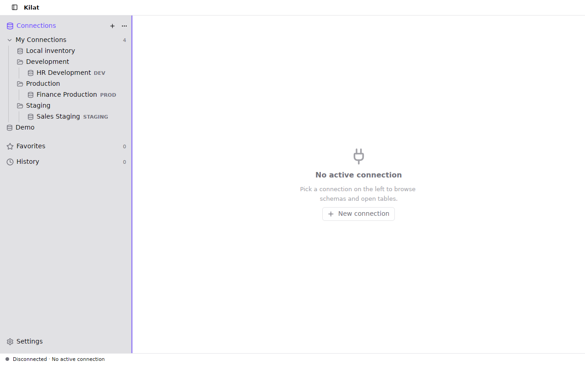 | 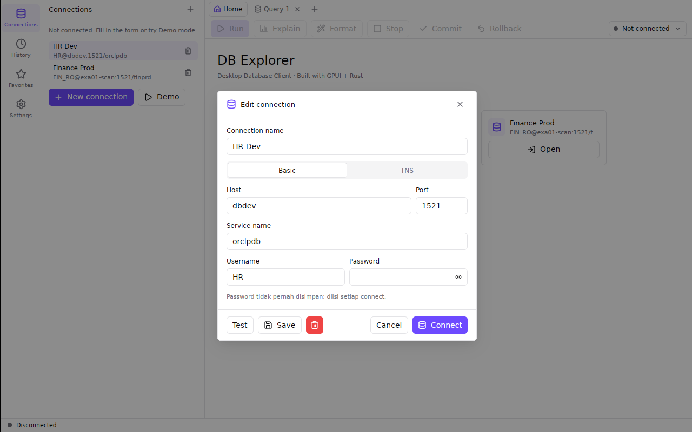 |  |
| **SQLite connection** | **SQLite data** | |
| 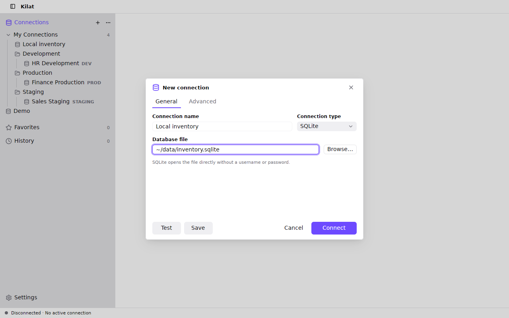 | 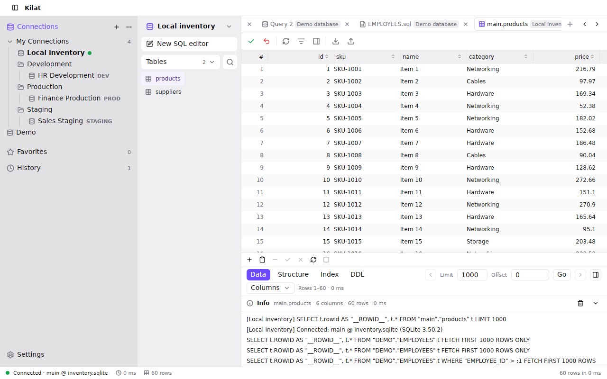 | |

### Explorer

- Schema dropdown, then an object type dropdown with counts: Tables, Views, Materialized Views, Indexes, Sequences, Procs (procedures, functions, packages), Triggers, Synonyms, Types and DB Links, plus a search box over a virtualized list. SQLite shows its tables, views, indexes and triggers.
- **Double click** a table or view to open its data in a new tab.
- **Right click** for Open Data, Describe, View Script (DDL from `DBMS_METADATA`), Export Data (CSV or XLSX), Import Data (CSV) and, on materialized views, Refresh Materialized View.
- **Quick Open** (Ctrl/Cmd+P) jumps to any table or view by name.

| Object types | Right click |
|---|---|
|  | 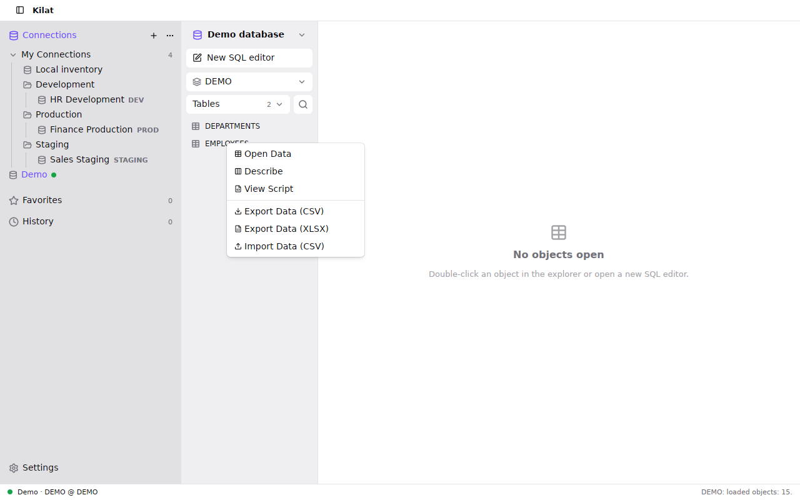 |

### Data grid

- Dense, virtualized grid with **Limit/Offset** paging (1,000 rows by default) and a **Columns** picker.
- **Filter bar** with AND/OR, values sent as bind variables, a SQL preview with Copy SQL and Open in SQL editor, and **Quick Filter** from a right click on a cell.
- **Edit in place**: double click a cell, paste a block of cells (TSV), add, **duplicate** or delete rows. Pending changes are coloured until you Apply, and nothing is committed until you press Commit.
- Copy rows as values, field names, INSERT/UPDATE statements or TSV.
- Bottom tabs **Data / Structure / Index / DDL**, a **Details** panel for the selected row, and an **Info** panel for the query log and errors.

| Filter bar with SQL preview | Pending edits and a duplicated row |
|---|---|
| 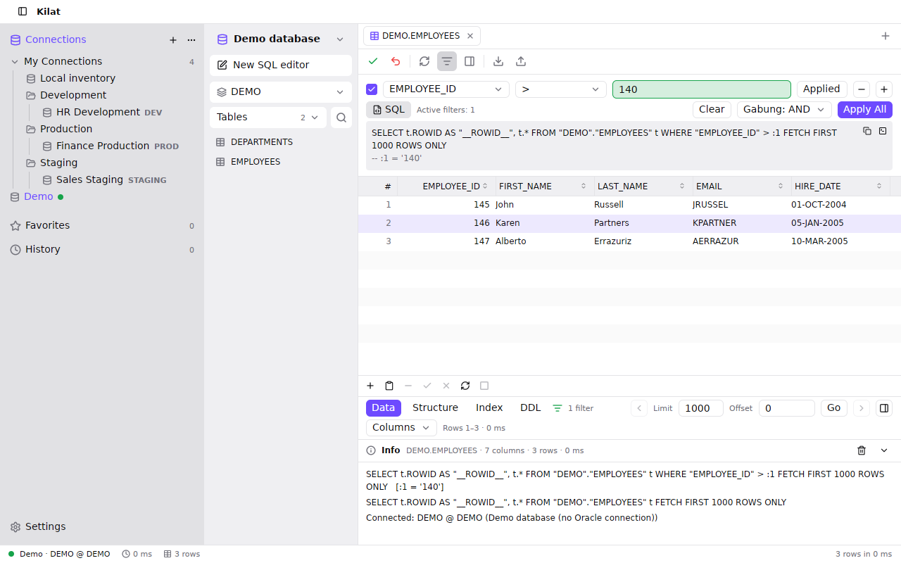 | 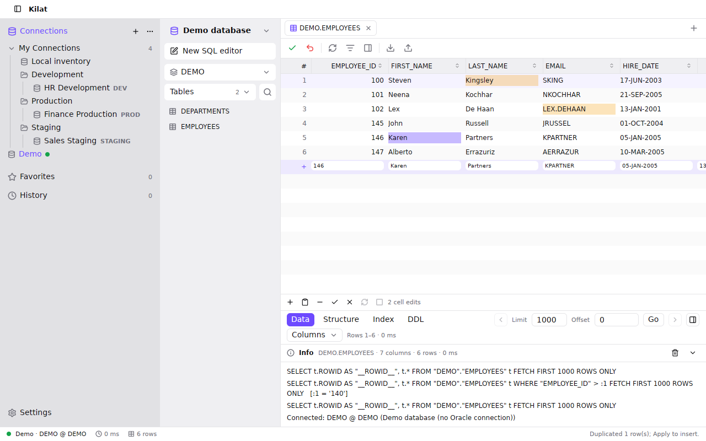 |
| **Grid context menu** | **View Script** |
| 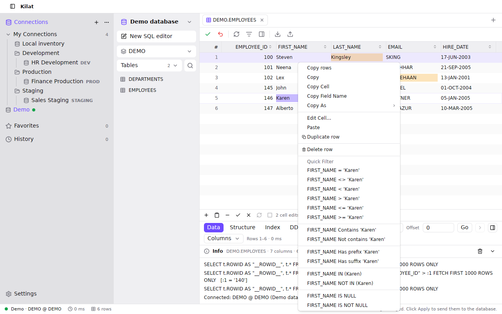 | 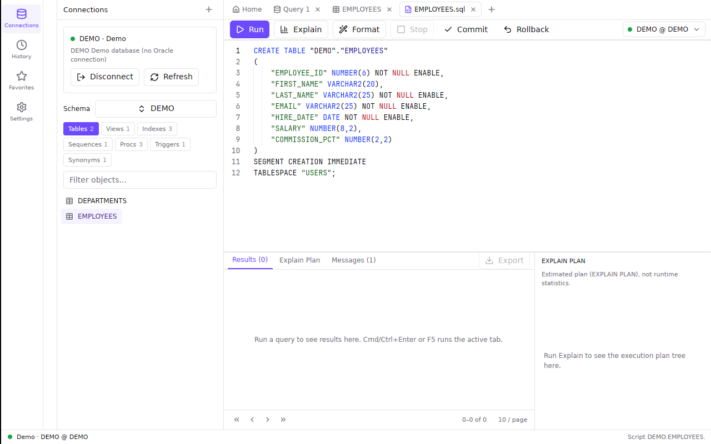 |

### SQL editor

- Syntax highlighting, line numbers, folding and multiple tabs. **Beautify SQL**, Save SQL.
- **Autocomplete** as you type (or Ctrl+Space): tables after `FROM`/`JOIN`, columns after `alias.`, objects after `schema.`, keywords and functions.
- **Run** (Ctrl/Cmd+Enter or F5) and **Run Current** (the selection or the statement under the cursor). Results come back in a grid of up to 1,000 rows; export them as CSV or XLSX.
- **Explain Plan** as a tree plus the `DBMS_XPLAN` text (SQLite: `EXPLAIN QUERY PLAN`).
- Explicit **Commit** and **Rollback**; there is no auto-commit. Query **History** with favourites.

| Autocomplete | Explain Plan |
|---|---|
| 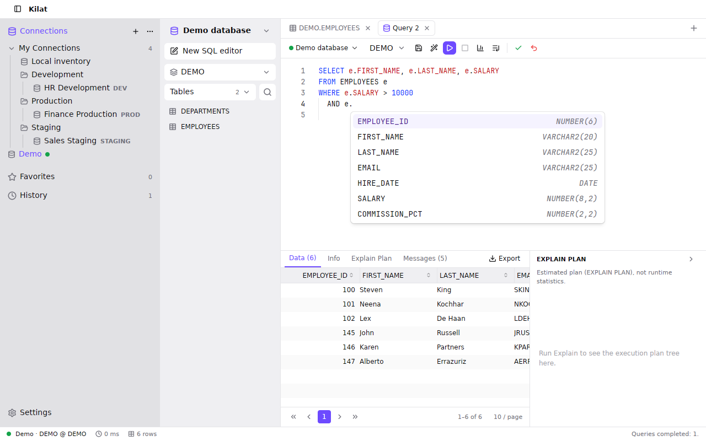 |  |

### App

- 30+ colour themes from gpui-kit plus Kilat's own violet default, separate picks for light and dark mode, accent colours, UI and editor font size, reduce motion, and two app icons.
- **Settings > Logs** shows recent errors and the crash log, with Copy report and Open folder.
- **Updates**: Kilat checks GitHub Releases at most once a day (it can be turned off). A download is installed only when both its SHA-256 checksum and its [minisign](https://jedisct1.github.io/minisign/) signature match the public key in [release-key.pub](release-key.pub). A proxy for update traffic can be set in Settings > About Kilat.

| Appearance | Updates and proxy | Dark mode |
|---|---|---|
| 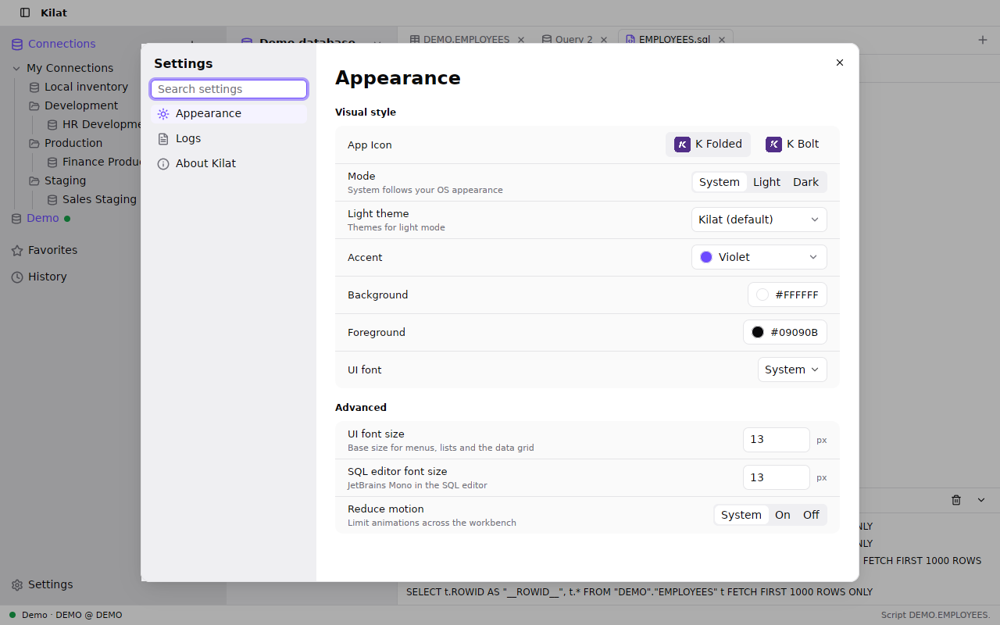 |  |  |

## Install

Download the latest file for your system from [Releases](https://github.com/abu-abbas/kilat/releases). Each release carries `SHA256SUMS` and a `.minisig` signature per file; see [docs/release-signing.md](docs/release-signing.md) to check them by hand.

### Windows (x86_64)

Download `Kilat-<version>-windows-x86_64.exe` and run it. It is a single portable executable with no installer; put it wherever you like. The file is not code signed, so Windows SmartScreen may say it protected your PC: click **More info**, then **Run anyway**.

### macOS (Apple Silicon)

Download `Kilat-<version>-macos-arm64.dmg`, open it and drag **Kilat** to Applications. Only Apple Silicon (M1 and later) builds are published. The app is ad-hoc signed but not notarized, so the first time macOS blocks it: right click Kilat in Applications and choose **Open**, then **Open** again (on recent macOS, use System Settings > Privacy & Security > **Open Anyway**). macOS may ask for Keychain access the first time a saved password is read.

### Linux (x86_64)

Download `Kilat-<version>-linux-x86_64.tar.gz`, then:

```sh
mkdir kilat && tar -xzf Kilat-*-linux-x86_64.tar.gz -C kilat
sh kilat/install.sh              # installs to ~/.local/bin and ~/.local/share, no sudo
sh kilat/install.sh --uninstall  # removes it again
```

The installer adds a launcher entry and icons, so Kilat appears in the app menu. A working Vulkan driver is required.

### Where Kilat keeps its files

Connections, settings, `errors.log` and `crash.log` live in a folder named `Kilat`. Installs from before the rename have their `gpui-like-toad` folder moved over automatically on first start (nothing is deleted if the move fails):

| OS | Folder |
|---|---|
| macOS | `~/Library/Application Support/Kilat` |
| Windows | `%APPDATA%\Kilat` |
| Linux | `$XDG_CONFIG_HOME/Kilat`, usually `~/.config/Kilat` |

The binary, the macOS bundle identifier and the keychain service are called `kilat`. Saved passwords from `gpui-like-toad` builds are copied to the new keychain service the first time they are needed; the old entries are left in place.

## Build from source

Requirements:

- Rust 1.92 or newer (`rustup update stable`).
- **Linux** (Ubuntu 24.04):

  ```sh
  sudo apt install -y gcc g++ clang libfontconfig-dev libwayland-dev \
    libwebkit2gtk-4.1-dev libxkbcommon-x11-dev libx11-xcb-dev \
    libssl-dev libzstd-dev libasound2-dev vulkan-validationlayers libvulkan1
  ```

- **Windows**: Visual Studio 2022 Build Tools with the *Desktop development with C++* workload (MSVC toolchain, not GNU) and CMake on `PATH`.
- **macOS** 15+: Xcode Command Line Tools.

```sh
cargo run -p kilat
```

The first build takes a while because gpui-kit is large. Set `ORA_DEMO=1` to get a **Demo** connection in the sidebar: an in-memory Oracle look-alike with `EMPLOYEES`, `DEPARTMENTS` and `DUAL`, handy for trying the UI without a server. The screenshots above were taken that way, under Xvfb on Linux.

```sh
cargo test --workspace
```

## Project layout

```
crates/
  ora-core/       No GUI: DbClient trait, result model, SQL dialects, filters,
                  edits, CSV/XLSX export, CSV import, profiles, update logic,
                  demo backend.
  ora-driver/     DbClient for Oracle on rust-oracledb (thin mode).
  sqlite-driver/  DbClient for SQLite on rusqlite; shipped as the downloadable SQLite extension (crates/ext-sqlite), not linked into the app.
  app/            gpui-kit GUI: workbench, explorer, grid, editor, settings,
                  updater, one worker thread per connection.
vendor/oracledb/  rust-oracledb pinned at b1adfff with the 10G verifier patch.
```

The UI never calls a driver directly: it sends a job over a channel to the connection's worker thread, which owns the `DbClient` and sends the response back.

The Oracle driver is vendored because every `oracledb` release on crates.io is yanked while the crate moves to Oracle, and Kilat needs a small login patch on top. The pinned upstream revision is noted in `vendor/oracledb/PATCHES.md`.

## Releases

Releases are made by hand: either run **Actions > Release > Run workflow** (optional version, default `0.1.<run number>`), or push a tag such as `v0.2.0`. The workflow builds Linux, Windows and macOS binaries, smoke tests `--version`, writes `SHA256SUMS`, signs every file with minisign and publishes a GitHub Release. The last five releases are kept. See [docs/release-signing.md](docs/release-signing.md).

## License

MIT, see [LICENSE](LICENSE). JetBrains Mono, used in the SQL editor, is bundled under the OFL (`crates/app/assets/fonts/OFL.txt`).
