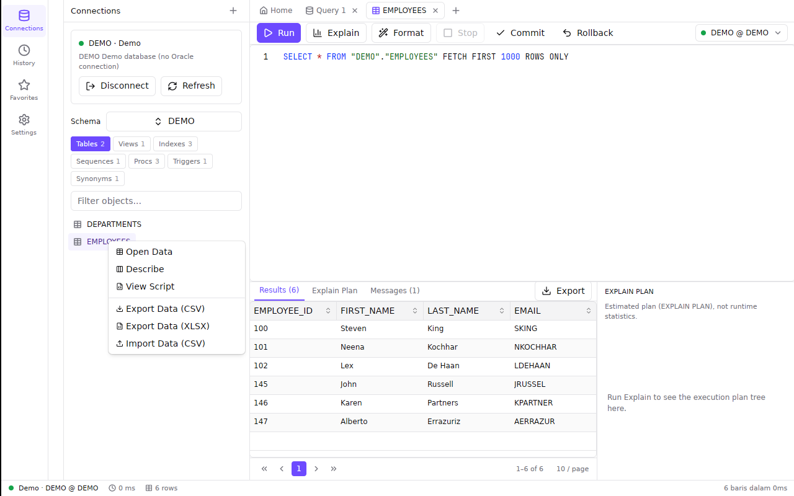
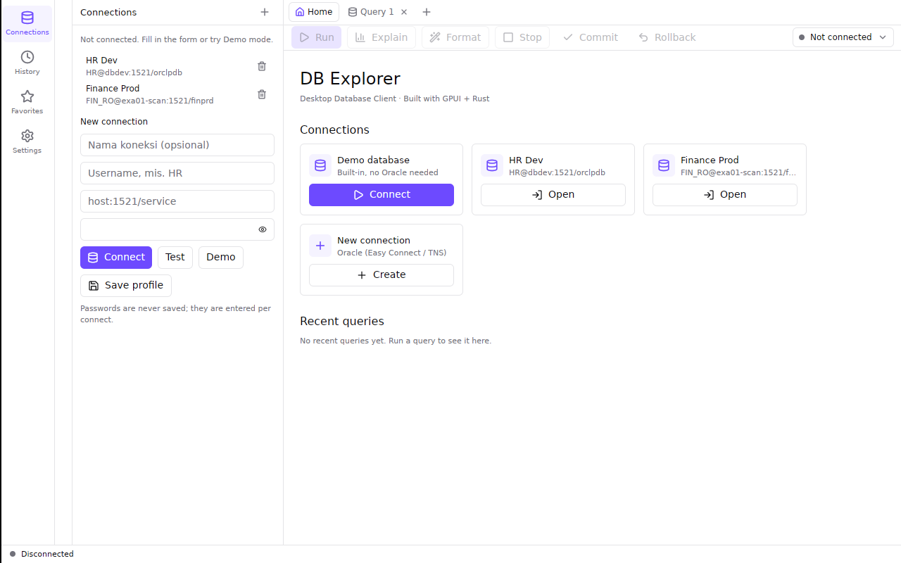
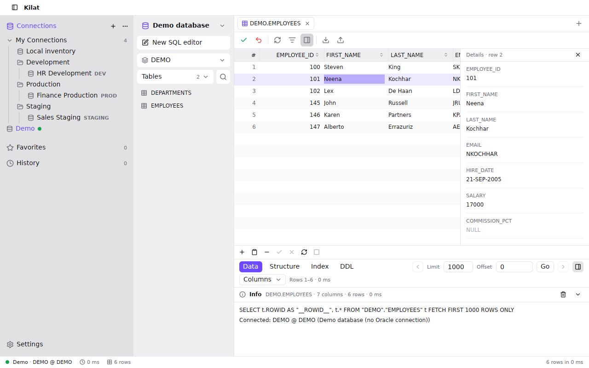
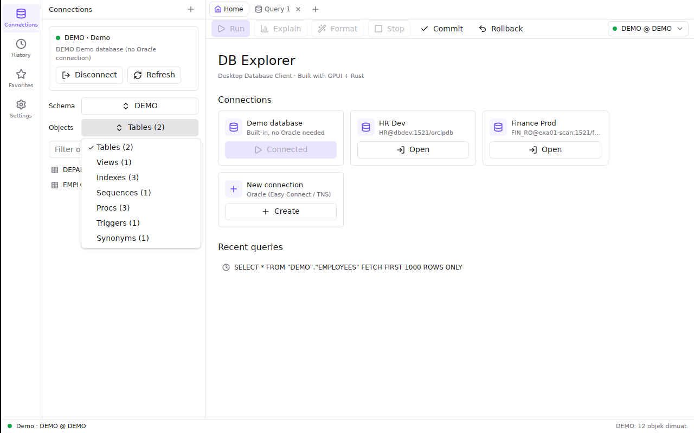

# Ora The Explorer

Semacam Toad for Oracle (namanya plesetan dari *Dora The Explorer*), tapi ditulis ulang di Rust dengan [gpui-kit](https://gpui-kit.com) — ringan, satu binary, tanpa install Oracle Client.

Nama tampilan app adalah **Ora The Explorer** (judul window, menu macOS, nama `.app`, file rilis). Nama crate/biner, folder config (`gpui-like-toad`), bundle identifier macOS, dan service keychain sengaja tetap `gpui-like-toad` supaya koneksi dan password yang sudah tersimpan tidak hilang.

> Status: MVP. Home ala Navicat, explorer ala Toad (dropdown schema, double klik buka data, klik kanan View Script / Export / Import), SQL editor, result grid, export, dan explain plan sudah ada.

## Fitur MVP



- **Layar awal ala Navicat** — tab Home berisi tile koneksi (Demo, profil tersimpan, New connection) dan riwayat query terakhir.
- **Connection manager** — dialog modal New/Edit connection dengan Host, Port, dan Service name terpisah (atau mode TNS untuk alias/descriptor), Test, Save, dan mode **Demo** yang jalan tanpa database sama sekali.
- **Explorer ala Toad** — dropdown schema (`ALL_USERS`), dropdown jenis objek (default Tables; Views, Indexes, Sequences, Procs, Triggers, Synonyms), kotak filter, dan daftar objek datar yang divirtualisasi.
  - **Double klik** table/view → tab data baru: grid penuh (100 baris per halaman, maks 1.000), panel Info di bawah untuk ringkasan dan error, tanpa editor SQL. Double klik objek lain → View Script.
  - **Klik kanan** → Open Data, Describe, **View Script** (DDL lewat `DBMS_METADATA.GET_DDL`, terbuka di tab baru), **Export Data** (CSV/XLSX seluruh tabel, maks 100.000 baris, lewat dialog Save), **Import Data** (CSV, header dicocokkan ke nama kolom, tidak auto-commit).
- **SQL editor** — tombol **New SQL** di toolbar membuka tab editor baru. Syntax highlighting SQL, nomor baris, folding, multi tab, Format. Run (Ctrl/Cmd+Enter, F5) untuk SELECT maupun DML/DDL/PL/SQL.
- **Result grid** — virtual scrolling, pagination, kolom bisa di-resize, klik header untuk sort. Hasil dibatasi 1.000 baris dan UI-nya bilang kalau terpotong.
- **Export hasil query** — CSV/XLSX dari grid ke working directory.
- **Explain plan** — tree plan + teks `DBMS_XPLAN.DISPLAY`.
- **Commit / Rollback** — eksplisit, tidak ada auto-commit.

| Home | New connection | Tab data |
|---|---|---|
|  |  |  |
| **Jenis objek** | **View Script** | |
|  |  | |

Screenshot diambil dari mode Demo di Xvfb (Linux, render Vulkan software).

Yang sengaja belum ada di MVP: dock layout yang bisa di-drag, shortcut F5/F9, save dialog native, autocomplete, session browser, PL/SQL debugger. Semuanya tercatat sebagai follow-up, bukan lupa.

## Cara jalan

### Prasyarat

- Rust 1.92+ (`rustup update stable`).
- Linux (Ubuntu 24.04, sesuai panduan gpui-kit):

  ```sh
  sudo apt update
  sudo apt install -y gcc g++ clang libfontconfig-dev libwayland-dev \
    libwebkit2gtk-4.1-dev libxkbcommon-x11-dev libx11-xcb-dev \
    libssl-dev libzstd-dev libasound2-dev vulkan-validationlayers libvulkan1
  ```

  Jalan di sesi grafis Wayland/X11 dengan driver Vulkan yang berfungsi.
- Windows: Visual Studio 2022 Build Tools/Community workload **Desktop development with C++** (toolchain MSVC, bukan GNU) + CMake di `PATH`.
- macOS 15+: Xcode Command Line Tools.

Tidak perlu Oracle Client / Instant Client: driver-nya thin mode, ngomong langsung protokol Oracle Net.

### Build & run

```sh
cargo run -p gpui-like-toad
```

Build pertama lama (gpui-kit besar); build berikutnya jauh lebih cepat. Profil dev di workspace sudah mengoptimalkan crate framework-nya supaya aplikasi tetap responsif saat development.

### Mode Demo (tanpa database)

Klik **Connect** di tile *Demo database* (atau **Demo** di panel kiri). Database demo in-memory menjawab `EMPLOYEES`, `DEPARTMENTS`, dan `DUAL`, jadi explorer, double klik tabel, View Script, export/import, dan explain bisa dicoba tanpa Oracle sama sekali.

### Konek ke Oracle

Isi username, connect string, dan password, lalu **Connect**. Connect string bisa:

- Easy Connect: `dbhost:1521/orclpdb`
- Connect descriptor penuh: `(DESCRIPTION=(ADDRESS=...)(CONNECT_DATA=(SERVICE_NAME=...)))`
- Alias `tnsnames.ora` (driver membaca file konfigurasinya)

Password tidak pernah ditulis ke file profil (`connections.json`). Kalau centang **Save password** di dialog koneksi, password disimpan di keychain OS (macOS Keychain, Windows Credential Manager, Secret Service/GNOME Keyring di Linux) dengan service `gpui-like-toad` dan account = id profil, lalu **Open**/**Connect** langsung jalan tanpa dialog. Lepas centangnya atau hapus profilnya, entri keychain ikut dihapus. Di macOS, build yang belum di-sign bisa minta izin Keychain lagi tiap habis build ulang.

Catatan: statement tidak boleh diakhiri `;` atau `/` saat dikirim ke driver — aplikasi otomatis membersihkannya sebelum eksekusi.

## Font & ligature

- **Editor** memakai **JetBrains Mono** v2.304 yang di-bundle di `crates/app/assets/fonts/` (lisensi OFL, lihat `OFL.txt` di folder yang sama) — tampilannya sama di semua mesin, font terinstall atau tidak.
- **Ligature kode** (`->`, `=>`, `!=`, `===`, ...) aktif: text system membiarkan fitur OpenType `calt` menyala secara default, dan tidak ada jalur di editor yang mematikannya.
- **UI** memakai **JetBrains Sans** kalau terinstall di sistem (misalnya bawaan JetBrains IDE); kalau tidak ada, fallback ke font default platform. JetBrains Sans tidak di-bundle karena tidak ada rilis OFL-nya — hanya tersedia sebagai webfont dari CDN JetBrains.

## Arsitektur

Workspace tiga crate, supaya logika database bisa dites tanpa GUI:

```
crates/
  ora-core/    # Tanpa GUI: trait DbClient, model hasil, export CSV/XLSX,
               # import CSV, helper SQL, backend demo in-memory.
  ora-driver/  # Implementasi DbClient di atas driver resmi Oracle
               # (rust-oracledb, thin mode). Satu-satunya crate yang
               # tahu soal driver.
  app/         # GUI gpui-kit: workbench, worker thread database,
               # adapter result grid, explorer objek.
```

Alur database: UI → `Job` (channel) → satu worker thread yang memiliki `DbClient` → `Response` → UI. Driver bersifat blocking, jadi tidak pernah dipanggil dari UI thread.

## Driver Oracle: kenapa git dependency

Per 16 November 2026, **semua** versi crate `oracledb` di crates.io berstatus *yanked* (crate independen sedang diserahterimakan ke Oracle), dan tidak ada crate bernama `rust-oracledb`. Satu-satunya sumber yang bisa di-resolve saat ini adalah repo resmi Oracle:

```toml
oracledb = { git = "https://github.com/oracle/rust-oracledb", rev = "b1adfff18b7240bfbe82b5148c0f114c6471feb6" }
```

Revisi di-pin ke commit yang diverifikasi tanggal tersebut (`26.0.0-beta.7`, pre-release). Kalau Oracle menerbitkan versi crates.io yang tidak di-yanked, dependensi ini bisa diganti ke versi crates.io tanpa mengubah kode lain — `DbClient` mengisolasi GUI dari driver.

## Verifikasi

Yang sudah dibuktikan mesin (bukan klaim):

- `cargo test --workspace` hijau (ora-core 44, app 11, ora-driver 4 test), termasuk round-trip export → import CSV lewat worker dengan backend demo.
- `cargo clippy -p ora-core -p ora-driver --all-targets -- -D warnings` hijau.
- GUI terkompilasi dan dijalankan di Linux (Xvfb + Vulkan software); screenshot di `docs/screenshots/` diambil dari build itu dalam mode Demo.
- Belum diuji ke Oracle sungguhan: `list_schemas` (`ALL_USERS`) dan `object_ddl` (`DBMS_METADATA.GET_DDL`) di `ora-driver` baru terbukti kompil. Import memakai INSERT literal per baris, jadi kolom DATE bergantung pada `NLS_DATE_FORMAT` session.

CI (`ci.yml`) meniru pola Sistem Akademis: deteksi perubahan, cek judul PR (Conventional Commits), job test headless, job GUI per OS, Semgrep, dan agregator `ci-ok` sebagai satu-satunya required check.

## Rilis

Setiap push ke `main` yang menyentuh kode (atau manual via workflow_dispatch) membangun biner rilis Linux + Windows + macOS (ARM), lalu menerbitkannya sebagai GitHub Release di repo ini sendiri — repo sudah publik, jadi tidak perlu repo cermin seperti Sistem Akademis. Versi `0.1.<run_number>`, 5 rilis terakhir dipertahankan, dan tidak perlu setup secret apa pun (workflow memakai `GITHUB_TOKEN` bawaan). Setiap biner di-smoke-test dulu (`--version` harus mencetak versi yang sama dengan nomor rilis).

Biner belum ditandatangani; code signing menyusul.

## Roadmap (follow-up)

- Dock layout (panel bisa di-drag/tab) pakai komponen Dock gpui-kit.
- Shortcut Run (F5) dan Explain.
- Save dialog native untuk export CSV.
- Autocomplete nama tabel/kolom di editor.
- Penyimpanan profil koneksi terenkripsi (keychain OS).
- Fetch JSON/VECTOR sebagai teks JSON (saat ini tampil format Debug).
- Riwayat query.

## Lisensi

MIT.
